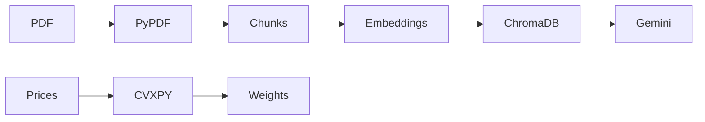

# FinSight AI

A financial document assistant and portfolio optimization project.

## Current Progress

- [x] Streamlit home page
- [ ] PDF upload and text extraction
- [ ] Document Q&A using LangChain and Gemini
- [ ] Semantic retrieval using ChromaDB
- [ ] Maximum-Sharpe and minimum-variance optimization using CVXPY
- [ ] Reports and charts

## Application Output


## Deployment

### Docker

From the repository root, build and run the app:

```sh
docker build -t finsight-ai .
docker run --rm -p 8501:8501 finsight-ai
```

Open `http://localhost:8501` in your browser. The container runs `app.py`
with Python 3.11 and the dependencies in `requirements.txt`.

For Gemini integration, pass your local secret through the environment:

```sh
docker run --rm -p 8501:8501 --env-file .env finsight-ai
```

Keep `GOOGLE_API_KEY` in your local `.env` file; do not commit it or put it
in the Docker image. The current home page does not use an API key.

### Streamlit Community Cloud

1. Sign in to Streamlit Community Cloud and connect your GitHub repository.
2. Create an app, choose the branch to deploy, and set the main file to `app.py`.
3. In Advanced settings, select Python 3.11 and add the Gemini secret in the
   secrets field using TOML:

   ```toml
   GOOGLE_API_KEY = "your-google-api-key"
   ```

4. Deploy the app. Community Cloud installs `requirements.txt` automatically.
   Keep the key in the app's secret settings, not in the repository.

## Architecture

The diagram shows the planned document and portfolio flows. As listed above,
this checkout currently implements only the Streamlit home page.


