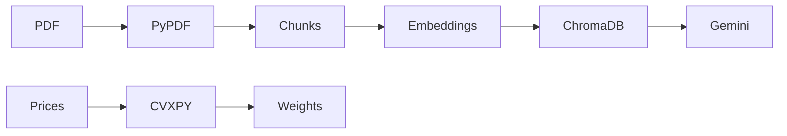
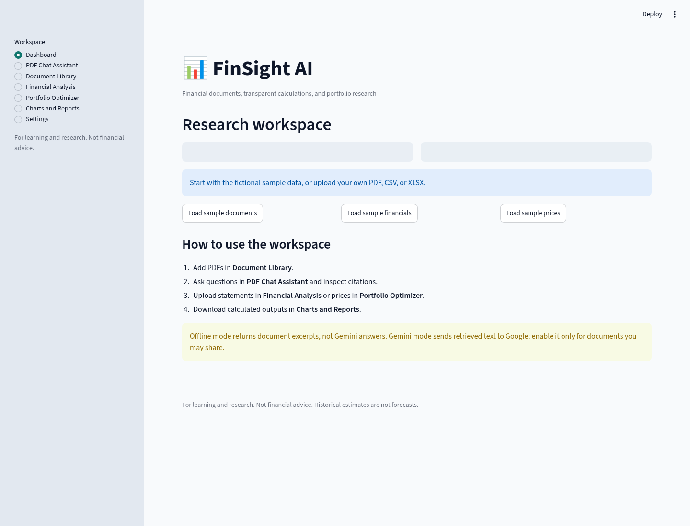
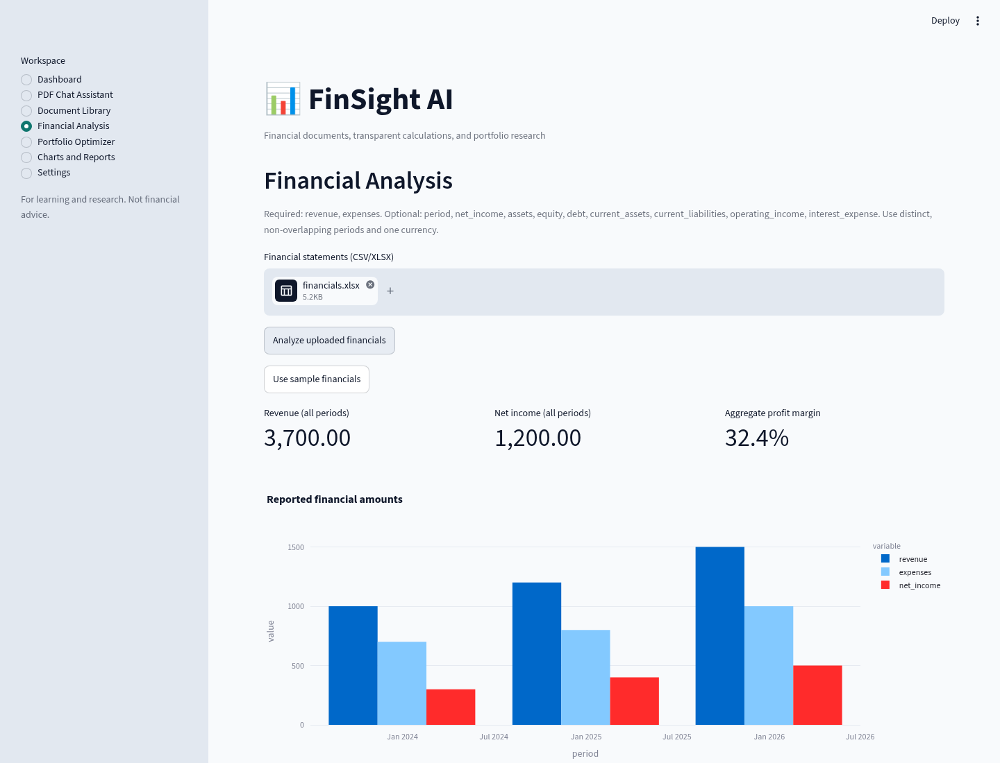

# FinSight AI

A portfolio project by **Umang Kumar**.

A financial document assistant and portfolio optimization project.

Explore PDFs with page citations, analyze CSV/XLSX financial statements, and
calculate long-only portfolio allocations in a seven-section Streamlit workspace.
Offline mode runs without API credentials. Gemini semantic embeddings and
grounded answers are optional and require a Google API key. This is a research
application; historical calculations are not investment advice or forecasts.

## Tech stack

Python 3.11/3.12, Streamlit, LangChain text splitters and Google adapter, Gemini
(optional), embedded ChromaDB, PyPDF, pdfplumber, Pandas, NumPy, scikit-learn,
CVXPY (CLARABEL/SCS), Plotly, and OpenPyXL. Development uses pytest, pytest-cov,
and ReportLab for fictional fixtures. Optional OCR uses Tesseract and PDFium.

## Current Progress

- [x] Streamlit home page
- [x] PDF upload and text extraction
- [x] Document Q&A using LangChain and Gemini
- [x] Semantic retrieval using ChromaDB
- [x] Maximum-Sharpe and minimum-variance optimization using CVXPY
- [x] Reports and charts

## Application Output


## Deployment

### Docker

From the repository root, build and run the app:

```sh
docker build -t finsight-ai .
docker run --rm -p 8501:8501 finsight-ai
```

Open `http://localhost:8501` in your browser. The container runs `app.py`
with Python 3.11 and the dependencies in `requirements.txt`.

For Gemini integration, pass your local secret through the environment:

```sh
docker run --rm -p 8501:8501 --env-file .env finsight-ai
```

Keep `GOOGLE_API_KEY` in your local `.env` file; do not commit it or put it
in the Docker image. Offline excerpts and local calculations do not use an API key. Gemini mode requires it.

### Streamlit Community Cloud

1. Sign in to Streamlit Community Cloud and connect your GitHub repository.
2. Create an app, choose the branch to deploy, and set the main file to `app.py`.
3. In Advanced settings, select Python 3.11 and add the Gemini secret in the
   secrets field using TOML:

   ```toml
   GOOGLE_API_KEY = "your-google-api-key"
   ```

4. Deploy the app. Community Cloud installs `requirements.txt` automatically.
   Keep the key in the app's secret settings, not in the repository.

## Architecture

The diagram shows the document and portfolio flows. Offline mode substitutes
local lexical embeddings and retrieved excerpts for the Gemini steps.
See [architecture notes](docs/architecture.md) for the service boundaries and formulas.




## Quick start

Use Python 3.11 or 3.12 from the repository root:

```sh
python -m venv .venv
source .venv/bin/activate
# Windows PowerShell: .venv\Scripts\Activate.ps1
python -m pip install -r requirements-dev.txt
python scripts/make_sample_data.py
pytest -q
streamlit run app.py
```

Dependency versions are constrained by `requirements-lock.txt`. In the app,
click **Load sample documents**, **Load sample financials**, or **Load sample
prices** to explore fictional data. No real company or market results are implied.

For Gemini mode, copy `.env.example` to `.env` and configure `GOOGLE_API_KEY`
securely. Select **Gemini semantic** in Settings, then index documents for that
embedding mode; choose **Gemini answer** in PDF Chat Assistant. Offline lexical
retrieval is not a semantic model, and offline excerpts are not generated answers.
Live API integration remains unverified until the opt-in live test passes with a
usable key. Model names can be changed with `GEMINI_MODEL` and
`GEMINI_EMBEDDING_MODEL`.

## Windows VS Code setup

From the folder containing this audited checkout (Git, 64-bit Python 3.11 and
VS Code must be installed):

```powershell
code .
py -3.11 -m venv .venv
.\.venv\Scripts\python.exe -m pip install -r requirements-dev.txt
.\.venv\Scripts\python.exe -m pip check
.\.venv\Scripts\python.exe -m pytest -q
.\.venv\Scripts\python.exe -m streamlit run app.py
```

Activation is unnecessary. Select `.venv` with **Python: Select Interpreter** in
VS Code. Local runs use Linux; the workspace cleanup fix also passes full hosted
Windows Python 3.11/3.12 CI (see the Windows fix report). `requirements.txt` is sufficient for the deployed app;
`requirements-dev.txt` adds the tests and sample-data generator. Bundled samples
are already included, so generating them again is optional.

## Environment and Gemini models

Copy `.env.example` to an ignored `.env` only if one does not exist, then enter
the key in a local editor. Never put keys in Git, logs, screenshots, or chat.

| Variable | Purpose |
|---|---|
| `GOOGLE_API_KEY` | Required only for Google embeddings and generated answers |
| `GEMINI_MODEL` | Chat model override; default `gemini-2.5-flash` |
| `GEMINI_EMBEDDING_MODEL` | Embedding model override; default `models/gemini-embedding-001` |
| `RUN_LIVE_GEMINI` | Set to `1` only when explicitly enabling real API tests |

`GEMINI_MODEL=gemini-3.8-flash` is accepted as an environment override and covered
by a configuration test. Its actual availability is **not verified** here. Do not
assume a model exists because the string is configurable. The opt-in checker
queries both configured model metadata endpoints, then tests a generated reply
and the sample PDF pipeline. It reports authentication/model/quota failures
without exposing provider payloads.

```powershell
if (!(Test-Path .env)) { Copy-Item .env.example .env }
notepad .env
# Only after saving a usable key and choosing to make real API calls:
.\.venv\Scripts\python.exe scripts\verify_live.py --live
$env:RUN_LIVE_GEMINI = "1"
.\.venv\Scripts\python.exe -m pytest -q -m live
Remove-Item Env:RUN_LIVE_GEMINI
```

The normal test suite does not need credentials. API calls may incur charges.
Offline excerpts are retrieval results, not Gemini-generated answers.

## Workspace and features

| Section | What you can do |
|---|---|
| Dashboard | Load fictional examples and see current session data |
| PDF Chat Assistant | Retrieve supporting pages, choose offline excerpts or cited Gemini answers, keep conversation history, filter by document |
| Document Library | Index multiple PDFs, deduplicate repeated uploads, delete documents, inspect/export detected tables, opt into scanned-page OCR |
| Financial Analysis | Upload CSV/XLSX, validate and sort data, calculate profit, ratios and growth, view interactive charts |
| Portfolio Optimizer | Upload prices, inspect correlations, solve min variance/max Sharpe, set asset caps, see frontier and allocation charts |
| Charts and Reports | Download financial/portfolio JSON, ratio/frontier CSV, standalone chart HTML, and chat with sources |
| Settings | Choose embedding provider and inspect credential presence, models, storage and privacy notes |

Uploads are bounded to 20 MB per file. PDFs are limited to 100 pages,
20 documents and 5,000 chunks per selected index. PDF text and index data are
session-specific; there is no account system or durable cloud document storage.
Optional OCR requires `requirements-ocr.txt` and Tesseract on the host. Raw table
extraction does not automatically map arbitrary statements into financial schemas.

## Input formats and calculations

Financial CSV/XLSX (first sheet) requires `revenue` and `expenses`. Optional
columns: `period`, `net_income`, `assets`, `equity`, `debt`, `current_assets`,
`current_liabilities`, `operating_income`, `interest_expense`, `cash`, `liabilities`.
Use a single currency and non-overlapping periods. Provided net income is retained;
otherwise it is revenue minus expenses. Undefined ratios are blank, not zero.
`revenue_growth`/`profit_growth` compare adjacent rows; `revenue_yoy_growth` and
`profit_yoy_growth` require the matching reporting date one calendar year earlier.

```csv
period,revenue,expenses,net_income,assets,equity
2024-12-31,1200,800,400,2400,1500
2025-12-31,1500,1000,500,3000,1900
```

Portfolio data uses `date` and one positive adjusted-price column per asset,
with at least 10 aligned observations and 2–50 assets. Prices must be in one
currency. The default annualization is 252 observations/year. Min variance and
max Sharpe use historical arithmetic means and sample covariance, long-only
fully invested weights, and an optional asset cap. The UI explains omitted costs,
solver status and assumptions; there is no trading execution or backtest claim.

See [sample inputs](data/samples), [calculation definitions](docs/architecture.md),
and [actual generated examples](docs/examples). All inputs there are synthetic.

## Tests and reproducible examples

```sh
python -m pip check
pytest -q --junitxml=test-results.xml --cov=src --cov-report=term-missing
python scripts/evaluate.py
# Optional live API test (after secure key configuration; may incur API charges)
RUN_LIVE_GEMINI=1 pytest -q -m live
```

The default tests exercise real local Chroma retrieval, PDF extraction, financial
formulas, solver constraints, an analytic min-variance case, a brute-force
max-Sharpe comparison, and Streamlit workflows. Provider transport is mocked in
unit tests; the live test is explicitly skipped without credentials and opt-in.
OCR tests skip if optional dependencies are missing. Read the [current audit and test report](docs/repository_audit.md) and [historical testing
report](docs/testing_report.md) for executed results and deployment limitations.

## Screenshots from the running app

These captures use only fictional bundled data. Dashboard and financial analysis
were recaptured during the current audit; PDF chat, portfolio and the original
home page are retained from earlier real local runs.






## Project structure

```text
app.py                      Streamlit UI
src/                        Config, PDF parsing, embeddings, RAG, finance, portfolio
requirements-dev.txt        Development/test dependencies
scripts/make_sample_data.py  Deterministic fictional examples
scripts/verify_live.py       Explicitly enabled model/API/PDF checks
scripts/evaluate.py          Local pipeline and exported output examples
tests/                      Unit, integration, UI, optional OCR/live-provider tests
data/samples/               PDF, CSV, XLSX and retrieval labels
docs/examples/              Generated calculation/retrieval outputs and chart
docs/                       Architecture, deployment, research, checklist, test evidence
.streamlit/config.toml      Upload limits and theme
Dockerfile                  Python 3.11 image and health check
.github/workflows/ci.yml     Python 3.11/3.12 tests, reports and Docker smoke check
```

See the [Windows workspace cleanup fix and verification commands](docs/windows_cleanup_fix.md)
for Chroma 1.5.9 session-lock handling and platform test evidence.

## Documentation and deployment boundary

- [Architecture and formulas](docs/architecture.md)
- [Local VS Code, Docker, Community Cloud and optional OCR](docs/deployment.md)
- [Five open-source project reviews and licensing notes](docs/github_research.md)
- [Implementation checklist](docs/implementation_checklist.md)
- [Current repository audit, test evidence, and readiness](docs/repository_audit.md)
- [Historical test evidence and limitations](docs/testing_report.md)

This repository prepares a deployable research app, not a certified production
financial service. Public untrusted uploads require authentication, isolated
parser workers, quotas, encrypted storage/retention and security review. Prompt
instructions and citation-label validation do not guarantee factual correctness.
No production deployment, cloud publish, merge, model accuracy or investment
performance is claimed. No upstream project source was copied; research links
and license notes are recorded in `docs/github_research.md`.
