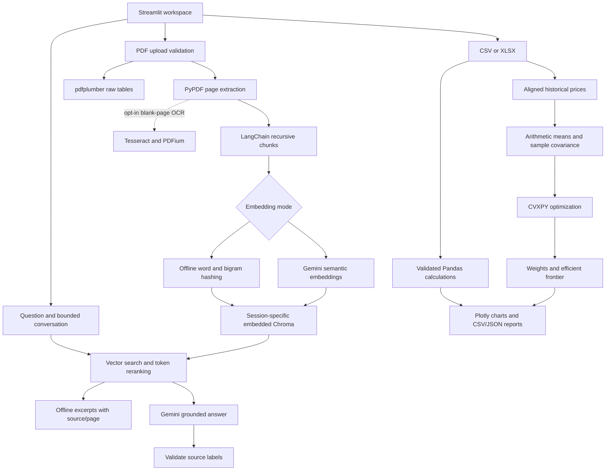

# Architecture and calculation notes

FinSight is a single Streamlit process with independently testable Python
services. There is no remote database, autonomous agent, brokerage connection,
or automatic deployment. A browser session owns its index and chat history.

## Modules

| Module | Responsibility |
|---|---|
| `app.py` | Seven UI sections; session state and download actions |
| `src/config.py` | Environment configuration; credential excluded from repr |
| `src/documents.py` | PDF signature/size/page limits, cleaning, metadata-preserving chunking, raw tables, optional OCR |
| `src/embeddings.py` | Local lexical hashing, Gemini adapter, normalized vectors, bounded retries and sanitized errors |
| `src/workspace.py` | Own session paths/clients, explicit close before cleanup, best-effort finalizer |
| `src/rag.py` | Content-addressed ingestion, deduplication, model-separated Chroma collections, search/filter/delete and cited answers |
| `src/finance.py` | CSV/XLSX loading, schema validation, ratios, growth, safe exports |
| `src/portfolio.py` | Price validation, moments, min variance, max Sharpe, efficient frontier |
| `src/evaluation.py` | Labeled source/page retrieval recall and reciprocal rank |
| `scripts/` | Reproducible synthetic input and actual offline output generation |
| `tests/` | Unit, backend integration, real UI, optional OCR and live Gemini tests |

## Documents and retrieval

PDFs are parsed from bytes, not saved under client filenames. Names are sanitized
display metadata; IDs hash filename plus bytes. Pages remain one-based and chunks
never cross page boundaries. The current limits are 20 MB/file, 100 pages/file,
20 documents/index, 5,000 chunks/index, and 2 million extracted characters/PDF.
LangChain splits into 1,000-character chunks with 150-character overlap.

The local provider hashes word unigrams/bigrams into normalized 768-dimensional
vectors. It is **lexical**, not a learned semantic model. Gemini mode uses
`models/gemini-embedding-001`, reduced to 768 dimensions and normalized; model
names are configurable. Model-specific collections prevent mixed embedding spaces.
Remote embeddings complete before index writes; a failed write removes partial
records. Content hashes make repeated uploads idempotent.

A query retrieves up to three times the requested results, reranks using 80%
cosine similarity and 20% token overlap, prefers distinct pages, and drops very
low-scoring candidates. These heuristic weights are not tuned accuracy claims.
Scores are not probabilities. History is bounded to 40 displayed messages; the
last six messages go to Gemini. Changing the document scope clears the chat,
so previous document excerpts are not forwarded into a new scope. Retrieval uses the current question, so ambiguous
follow-ups should restate the subject. There is no automatic question rewriting.
The prompt treats history/documents as untrusted data. Citation labels are checked
for membership in the retrieved source list; this does **not** prove every model
claim is entailed. Always inspect the displayed page excerpts.

## Financial calculations

Input amounts must share a currency and reporting periods must not overlap.
Revenue/expenses are required and nonnegative; provided net income is preserved,
otherwise it is `revenue - expenses`. Currency conversion and accounting
standardization are outside scope. Rows sort chronologically when `period` exists.

- Profit margin = net income / revenue.
- Current ratio = current assets / current liabilities.
- Debt/equity = debt / equity.
- ROA and ROE = net income / period-end assets or equity (not average balances).
- Interest coverage = operating income / interest expense.
- Period growth = (current - prior row) / prior row, only for a positive prior value.
- YoY growth = (current - matching prior-year reporting date) / prior-year value;
  absent/nonpositive prior-year values are undefined.

Optional ratios appear only when their input columns exist. Missing or invalid
numeric input is rejected. Undefined ratios are blank/NaN in CSV, not invented
zeros; summaries use JSON null. Spreadsheet formulas are neutralized in textual
CSV exports. PDF tables are raw detected grids, not automatically reconciled
financial statements.

## Portfolio mathematics

Prices must be positive and aligned. Daily simple returns are `P[t]/P[t-1]-1`;
frequency defaults to 252 but supports other regularly spaced observations.
Annual mean is sample arithmetic mean times frequency; covariance is sample
covariance times frequency. Covariance is symmetrized and eigenvalues floored at
1e-10 for numerical stability. These estimates are in-sample, not forecasts.

Minimum variance minimizes `wᵀΣw` with `sum(w)=1` and `0<=w<=cap`.
For maximum Sharpe with positive feasible excess return, set
`y=w/((μ-rf)ᵀw)`, minimize `yᵀΣy` subject to `(μ-rf)ᵀy=1`, `y>=0`, and
`y_i<=cap*sum(y)`; recover `w=y/sum(y)`. The cap is enforced in transformed
coordinates. Nonpositive/infeasible excess return is rejected explicitly.
The efficient frontier solves minimum variance above increasing feasible return
targets under the same cap. CLARABEL is primary, SCS is a fallback; solver status
and normalized constraint checks are surfaced. Taxes, leverage, transaction costs,
slippage, walk-forward validation, and trading execution are not modeled.

## Privacy, reliability, and deployment boundary

The UI uses a per-session TemporaryDirectory and no global document cache.
Uploaded PDFs stay in memory; extracted text persists locally for that session.
Deleting a document deletes its indexed chunks and clears UI chat. “Clear this
session workspace” deletes all its collections. Temporary storage is neither
an encrypted vault nor durable cross-restart storage. The session owner closes all cached model-specific clients using Chroma’s public
`close()` before directory cleanup. Finalization repeats that order and ignores
external file-lock cleanup errors while recording a safe warning. This is best
effort; an operator still needs a retention policy.

API timeouts and bounded exponential retry handle selected transient failures;
errors shown/logged do not include provider payloads or keys. Application logs
record categories only. Gemini mode sends selected text to Google; offline mode
does not. Optional OCR caps rendered pixels and has a 20-second Tesseract timeout.

This is a deployable research application, **not a hardened public multi-tenant
service**. For hostile documents add authentication, per-user quotas, parser
worker isolation/time/memory limits, malware scanning, encrypted storage and
retention, audit controls, and organization-specific financial review. A byte/page
limit does not eliminate parser vulnerabilities or prompt injection. Deployment
is documented and container-tested where available, but no production deployment
or security certification is claimed.
